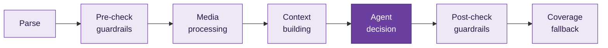

<p align="center">
  
</p>

<p align="center"><i>Originally built as part of the HackerRank Orchestrate 24-hour hackathon.</i></p>

<p align="center">
  
  
  
  
</p>

---

## 💜 What is Signalwise?

Messaging apps are noisy. **Signalwise** decides, for every incoming WhatsApp message, what the user should actually see:

| Decision | Meaning |
|---|---|
| 🔔 `notify` | Important, time-sensitive, or personally relevant. Interrupt the user. |
| 🗂️ `digest` | Useful but not urgent. Batch it into a summary. |
| 🔕 `mute` | Noise, spam, or a likely scam. Keep it out of the way. |

Each decision comes with a message type, a plain-language reason, a calibrated confidence score, and the historical message IDs that support it, so every routing choice can be audited.

For the full task specification that inspired the project, see [`problem_statement.md`](./problem_statement.md).

---

## ✨ Highlights

- **Safety first:** scam and spam detection take priority over everything else in the decision logic.
- **Personalised routing:** decisions use each user's own history, groups, and business relationships instead of generic rules.
- **Multimodal:** images are captioned and voice notes are transcribed with Gemini, so every message type can be reasoned over as text.
- **Prompt-injection resistant:** message content is treated as untrusted, and instructions hidden inside a message are never followed.
- **Never breaks the pipeline:** deterministic guardrails run before and after the model, and every input row is guaranteed exactly one output row.
- **Calibrated confidence:** scores reflect real certainty instead of defaulting to a high value.

---

## 🧭 How It Works



1. **Parse:** validates each raw CSV row into a structured `ParsedMessage`, flagging missing or malformed fields instead of dropping the row.
2. **Pre-check (guardrails):** cheap, deterministic checks catch unroutable messages early (no `user_id`, no content, failed media) and return a safe fallback without calling the model.
3. **Media processing:** images and voice messages go to Gemini for captioning and transcription. Failures fall back to a safe `digest`-style decision rather than crashing.
4. **Context building:** user, group, business, and historical data are indexed in memory once per run, then looked up per message to build repetition signals, spam-pattern detection, and candidate evidence message IDs.
5. **Agent decision:** a Gemini call (structured JSON output, temperature 0) returns the final `action`, `message_type`, `reason`, `confidence`, and `evidence_message_ids`.
6. **Post-check (guardrails):** clamps and normalises the model output (valid action and type, confidence in `[0, 1]`, non-empty reason) so malformed output can never corrupt the final CSV.
7. **Coverage fallback:** any `message_id` without a decision is filled with a `mute` fallback, so no input row goes missing.

---

## 🗂️ Repository Layout

```text
.
├── AGENTS.md                  # Agent workflow and logging rules for AI coding tools
├── problem_statement.md       # Original challenge statement
├── README.md                  # You are here
├── code/
│   ├── main.py                # Entry point: runs the full pipeline
│   ├── parser.py              # CSV parsing and row validation
│   ├── context.py             # Loads dataset CSVs into indices, builds per-message context
│   ├── tools.py               # Gemini-backed image captioning and voice transcription
│   ├── agent.py               # Gemini-backed routing decision (system prompt + call)
│   ├── guardrails.py          # Pre/post validation, fallbacks, CSV writer
│   └── tests/                 # Regression tests
└── dataset/
    ├── messages.csv           # Messages to route
    ├── output.csv             # Generated predictions (produced by main.py)
    ├── sample_messages.csv    # Solved examples
    ├── users.csv / groups.csv / group_members.csv
    ├── business_accounts.csv / user_business_history.csv
    ├── message_history.csv / message_events.csv
    ├── images.csv / voice_notes.csv
    ├── daily_notification_summary.csv
    └── media/
        ├── images/
        └── audio/
```

---

## 🛠️ Setup

**Requirements**

- Python 3.10+
- A Gemini API key (needed for the LLM-backed path; without it, messages fall back to a safe default decision)

**Install dependencies**

```bash
pip install google-genai pytest
```

**Configure your API key** with an environment variable (preferred) or a `.env` file at the repo root:

```bash
export GEMINI_API_KEY=your_key_here
```

```text
# .env
GEMINI_API_KEY=your_key_here
```

No secrets are hardcoded anywhere in the code.

---

## 🚀 Running Signalwise

From the repository root:

```bash
python code/main.py
```

This will:

- load `dataset/messages.csv` and all supporting context CSVs,
- route each message through the pipeline above,
- write one prediction row per message to `dataset/output.csv`.

Progress and any per-message errors are printed to stdout as the run proceeds.

---

## 📄 Output Format

`dataset/output.csv` uses these columns, in order:

```text
message_id,action,message_type,reason,confidence,evidence_message_ids
```

- `evidence_message_ids` is `none` when there is no useful historical evidence, otherwise a `;`-separated list of historical `message_id`s.
- `confidence` is clamped to `[0, 1]` and formatted to 2 decimal places.
- Every `message_id` in `messages.csv` gets exactly one output row, even on unexpected failures.

---

## ✅ Testing

```bash
cd code
python -m pytest tests/ -v
```

---

<p align="center">
  
</p>

<p align="center"><i>💜 Built by <a href="https://github.com/l253010">Eman Fatima</a></i></p>
